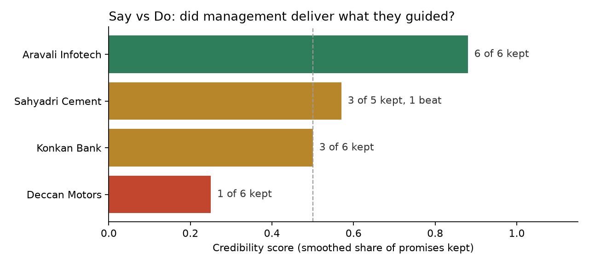

# Say vs Do: management credibility score

When a management team gives guidance on an earnings call, how often do they actually hit it?

This prototype reads earnings call transcripts, pulls out the forward-looking numbers management committed to, checks each one against what the company later reported, and rolls that up into a credibility score per company. Every promise in the output links back to the exact quote, the call it was made on, and the reported figure it was judged against.

It runs on 12 synthetic transcripts I wrote to test the method, and on 9 real Infosys earnings calls downloaded from SEC filings.



## The problem

Guidance moves stock prices, but there is no easy way to see whether a particular management team has a habit of over-promising. Right now an analyst would have to reread a year of transcripts and line them up against results by hand.

Who I had in mind:

- A retail user on Spectra asking "has Deccan Motors management been reliable on guidance?" and getting an answer with the quotes and dates attached.
- An institutional user on the Dashboard screening for companies that consistently guide low and beat, or the reverse.

Why this for Prism: "management guidance tracked against actual delivery" is already on Prism's list of company data, and building it needs both of the things Prism is working on. There's an LLM step that turns unstructured text into structured records, and a transparent quantitative layer on top of that. It's also a good test of the trust rule. If a number can't be traced back to a document, it shouldn't be shown.

## How it works

```
transcripts ──> extract guidance ──> verify quote ──> match to reported result ──> score ──> report
                (Claude, or my       (drop anything    (actuals.csv)                         (HTML, CSV, chart)
                 hand labels)         not in the text)
```

**1. Extract.** Each transcript goes to Claude with a fixed list of 8 metrics and a fixed output schema. A promise comes back like this:

```json
{
  "quote": "gross NPA should come down below 2.5 percent by end of Q2",
  "metric": "gross_npa_pct",
  "type": "at_most",
  "high": 2.5,
  "target_period": "Q2FY26"
}
```

**2. Verify.** The quote has to appear word for word in the transcript (ignoring case, whitespace, and curly vs straight quotes). If it doesn't, the record is marked `unverified_quote` and is never scored. It's a crude check, but it catches the failure I'm most worried about, which is the model inventing guidance. Records that are missing a number or a target period are marked `incomplete` instead of being guessed at. On a real call the same promise gets said two or three times (CEO, CFO, then in Q&A), so repeats within one call are counted once.

**3. Judge each promise** against the reported number for the period it was about:

| Guidance type | Example | Kept when |
|---|---|---|
| range | "6 to 8 percent" | actual is inside the range |
| at_least | "at least 21 percent" | actual >= target |
| at_most | "below 2.5 percent" | actual <= target |
| point | "around 15 percent" | actual within a tolerance (0.5pp default, 0.1pp for NIM and NPA, 2pp for utilization) |
| direction | "margins will improve from Q2" | actual moved the promised way vs the reference period |
| vague | "the EV platform will be a game changer" | not scored, but counted |

A promise that isn't kept but lands on the good side, like growth above the top of the range or NPA below the cap, is marked **beat** instead of missed. It still counts against the credibility score, because the forecast was wrong, but the report shows it separately. I added this after running the real Infosys data (below), where the plain kept/missed rule gave a misleading picture.

**4. Roll up per company.**

- `raw_score` is kept / scored, where scored is kept + beat + missed.
- `credibility_score` is (kept + 1) / (scored + 2), which is Laplace smoothing. With five or six promises per company, a team that kept 1 of 1 shouldn't rank alongside one that kept 6 of 6, so small samples get pulled toward 50%.
- `delivery_score` is the same, but counts a beat as delivered: (kept + beat + 1) / (scored + 2). Credibility asks whether management's numbers were accurate; delivery asks whether management delivered at least what it promised. A company that guides cautiously scores low on the first and high on the second.
- `avg_gap_pp` is the average distance between the reported number and the promised target, in percentage points. Positive means the company tends to beat its own guidance. For gross NPA, where lower is better, the sign is flipped. Direction promises have no numeric target, so they're left out of this.

The tolerances, the lower-is-better list and the metric list are all in `config.py`, so changing a methodology choice doesn't mean digging through the scoring code.

## Results

12 synthetic transcripts (4 companies, Q1 to Q3 FY26 calls), scored against FY26 reported results:

| Company | Kept | Raw score | Credibility | Delivery | Avg gap vs target |
|---|---|---|---|---|---|
| Aravali Infotech | 6 of 6 | 1.00 | 0.88 | 0.88 | +0.22 pp |
| Sahyadri Cement | 3 of 5 (1 beat) | 0.60 | 0.57 | 0.71 | -1.10 pp |
| Konkan Bank | 3 of 6 | 0.50 | 0.50 | 0.50 | -0.46 pp |
| Deccan Motors | 1 of 6 | 0.17 | 0.25 | 0.25 | -3.20 pp |

What I'd take from it:

- Aravali hit all six of its measurable targets, and narrowed its revenue range as the year went on, not the other way round.
- Deccan Motors missed 5 of 6, three of them by more than 3 points. It also kept restating volume targets it was nowhere near: at least 12% for FY26 in July, 15 to 18% for Q3 in October, still at least 10% for FY26 in January. Q3 came in at 11.2% and FY26 at 6.8%.
- Konkan's 0.50 hides a split. It missed both NIM targets and its original 16 to 18% loan growth range, but kept every asset-quality promise. A per-metric view would make that obvious, and it's the first thing I'd add.
- One of Sahyadri's promises is a beat. Management said Q4 margin would be lower than Q3 because of fuel costs, and it came in higher (19.4% to 19.9%). The forecast was wrong, so it counts against the score, but the report shows it as a beat and not a miss.

A Spectra-style answer this data could back up:

> Deccan Motors management has kept 1 of 6 measurable promises across its last three earnings calls. On the Q1 FY26 call (28 July 2025) the CFO guided FY26 volume growth of "at least 12 percent". Reported FY26 volume growth was 6.8%. The one promise kept was that Q3 EBITDA margin would improve on Q2 (said on the Q2 call, 27 October 2025), which it did: 11.6% to 11.9%. Sources: Q1 to Q3 FY26 call transcripts, Q2 and Q3 FY26 results releases, FY26 annual results.

Everything is in `outputs/`:

- `report.html`: the scoreboard plus every promise with its quote, call date, source file, target, reported number and verdict. Open it in a browser.
- `scoreboard.csv`: one row per company
- `scored_guidance.csv`: one row per promise
- `credibility_chart.png`: the chart at the top

## The LLM step and how to evaluate it

The scores above come from 28 statements I labeled by hand (`data/gold_guidance.json`). Those same labels are the test set for the LLM extraction, so "is the extraction good enough to trust?" gets answered with numbers.

`python run.py --use-llm` runs Claude over all 12 transcripts, scores the LLM's records instead of the hand labels, and writes `outputs/extraction_eval.json` with:

- recall and precision against the hand labels (did it miss promises, did it make any up)
- accuracy per field (metric, type, period, numbers, direction), so you can see which part the model gets wrong
- the share of quotes that actually appear in the transcript
- JSON parse failures and truncated responses
- each company's credibility score from the LLM records next to the score from the hand labels. This is the one I care about most, since it's what a user would actually see.
- average latency per transcript, total tokens, and estimated cost

### Results from a live run (Claude Sonnet 5.5, low effort)

| | |
|---|---|
| Statements found (recall) | 28 of 28 |
| Precision | 0.93 (2 extra records, see below) |
| Records correct on every field | 26 of 28 |
| Quotes found word for word in the transcript | 30 of 30 |
| JSON parse failures / truncated responses | 0 / 0 |
| Average latency | 2.2 s per transcript |
| Cost for all 12 transcripts | about $0.05 (11.5K input, 3.1K output tokens) |

| Company | Score from hand labels | Score from LLM |
|---|---|---|
| Aravali Infotech | 0.88 | 0.88 |
| Sahyadri Cement | 0.57 | 0.57 |
| Konkan Bank | 0.50 | 0.50 |
| Deccan Motors | 0.25 | 0.14 |

The full numbers are in `outputs/extraction_eval.json` and the model's records are in `data/llm_guidance.json`.

What went wrong, and what I take from it:

- **One ambiguous word moved a score by 11 points.** Deccan's CFO said "Margins will improve in Q3 from Q2 levels". I labeled that as EBITDA margin, since that's the only margin Deccan guides on. The model called it vague because the sentence doesn't say which margin. Both readings are defensible, but it removed Deccan's one kept promise, taking it from 1 of 6 to 0 of 5 (0.25 to 0.14). With this few promises per company, every labeling call matters. The fix I'd try first is giving the model the metrics each company has guided on before, so a bare "margins" can be resolved, and flagging it for review when it can't.
- **The two extra records aren't hallucinations.** "We believe deposit costs have peaked" (Konkan) and "We are also evaluating a few acquisition targets in the east" (Sahyadri) are real forward-looking statements that I didn't label. Both are vague, so neither affects a score. The 0.93 precision is really a disagreement about what counts as guidance, and that's a labeling rule I should write down.
- On one vague statement the model turned "next year" into FY27. Harmless, since vague statements aren't scored.
- The model usually quotes the whole sentence, including the reason ("...because of higher fuel costs", "Wage hikes are deferred to Q3 this year, so..."). The matcher handles it, and it's useful: the reason management gave is exactly what you'd want to show next to a miss.

On reproducibility: Sonnet 5.5 doesn't accept a temperature setting, so I can't force identical output. I ran the extraction twice to check. Both runs returned the same 30 records, 29 matched on every field, and the only one that changed was the same ambiguous "margins" sentence (vague both times). All four company scores were identical across the two runs. After extraction, everything is plain, unit-tested Python, so the model never does the math.

## Real data: Infosys

To see how the method holds up on data I didn't design, I ran it on one real company. Infosys works well for this because it gives explicit guidance for full-year revenue growth (in constant currency) and operating margin, and revises it every quarter.

**Getting the transcripts.** Infosys's own site and BSE both block scripted downloads (HTTP 403). But Infosys attaches the transcript of every earnings call to its SEC Form 6-K filings, and the SEC allows scripted access as long as each request includes a contact email. `fetch.py` lists Infosys's filings, finds the attachment labeled "TRANSCRIPT OF EARNINGS CALL" and converts the HTML into the same format as the synthetic transcripts. It pulled 9 calls, from Q4 FY24 (April 2024) to Q4 FY26 (April 2026), about 8,000 words each. In production I'd expect to license transcripts rather than scrape them.

**Reported results** come from the Infosys press releases attached to the same filings, with the link on every row of `data/infosys/actuals.csv`. FY26 operating margin needed a decision: it was 20.3% as reported and 21.0% excluding a one-time Labour Code charge. Infosys said its margin guidance excluded that charge, so I compare against 21.0%. It's inside the 20 to 22% band either way.

**Labels.** My labeling rule: a promise is management committing to a target for one of the 8 metrics, for a specific fiscal year or quarter, with a number or a direction. Tax rate, cash flow and hiring targets are out because they aren't in the metric list, and so is "H1 will be stronger than H2" because there's nothing to score it against. Each promise is labeled once per call, and the other sentences where it gets repeated are listed as `alt_quotes`. That gives 18 promises, two per call: a revenue growth range and an operating margin band.

| Guidance for | Said on | Promise | Actual | Result |
|---|---|---|---|---|
| FY25 revenue growth | Apr 2024 | 1 to 3% | 4.2% | beat |
| | Jul 2024 | 3 to 4% | 4.2% | beat |
| | Oct 2024 | 3.75 to 4.5% | 4.2% | kept |
| | Jan 2025 | 4.5 to 5% | 4.2% | missed |
| FY26 revenue growth | Apr 2025 | 0 to 3% | 3.1% | beat |
| | Jul 2025 | 1 to 3% | 3.1% | beat |
| | Oct 2025 | 2 to 3% | 3.1% | beat |
| | Jan 2026 | 3 to 3.5% | 3.1% | kept |
| FY25 and FY26 operating margin | all 8 calls | 20 to 22% | 21.1%, 21.0% | kept, 8 of 8 |
| FY27 revenue and margin | Apr 2026 | 1.5 to 3.5%, 20 to 22% | not reported yet | pending |

Overall: 10 kept, 5 beat, 1 missed and 2 pending, for a credibility score of 0.61, a delivery score of 0.89 and an average gap of +0.37 pp.

What it showed:

- **Infosys guides low and raises.** Five of its six misses were beats. It started each year with a cautious range, raised it as the year went on, and still finished above most of them. The one real miss was January 2025, when it guided 4.5 to 5% with one quarter left and FY25 came in at 4.2%. Before I added the beat verdict, all six counted as plain misses, which would have told a user the opposite of what happened. That's the main change real data forced.
- **0.61 measures accuracy, not reliability.** Infosys landed where it said 10 times out of 16, but fell short only once. That's why there's a second score: counting beats as delivered gives 0.89. Read together, 0.61 and 0.89 say "cautious, but dependable", which neither number says on its own.
- **A wide band is easy to keep.** The margin band was 20 to 22% on all 8 calls and was kept every time. That's a 2-point band that never moved, compared with a 0.5-point revenue range in January 2026. The score treats them the same, which flatters the margin promises.

**What had to change in the code.** The prompt and model call didn't change. The plumbing did:

- New `fetch.py` and `src/fetch_sec.py` to download and convert the transcripts. Speaker names are bold paragraphs, the participant headings vary from quarter to quarter, and one title page didn't name the quarter at all, so it's worked out from the call date.
- The quote check now treats curly and straight quotes as the same. The transcripts use curly ones and the model types straight ones back, so real quotes would have been flagged as invented.
- Repeated promises within a call are counted once, and the evaluation accepts any of the labeled sentences, so quoting the CFO where the label quotes the CEO isn't counted as an error.
- The evaluation also reports a measurable-only score, since real calls have a lot of vague talk about demand and deal pipelines that isn't labeled.
- The beat verdict.

### The LLM on the real calls

Same model, same effort and the same prompt as the synthetic run. I didn't change the prompt for real data, so this measures the original design.

| | |
|---|---|
| Measurable promises found (recall) | 18 of 18 |
| Correct on every field | 18 of 18 |
| Precision on measurable promises | 0.86 (3 extra, see below) |
| Quotes found word for word in the transcript | 68 of 69 |
| JSON parse failures / truncated responses | 0 / 0 |
| Average latency | 4.0 s per transcript |
| Cost for all 9 transcripts | about $0.36 (147K input, 6.4K output tokens) |
| Credibility score | 0.55 from the model's records, 0.61 from the hand labels |
| Delivery score | 0.80 from the model's records, 0.89 from the hand labels |

The full numbers are in `outputs/infosys/extraction_eval.json` and the model's records are in `data/infosys/llm_guidance.json`.

What happened:

- **The actual guidance was the easy part.** All 18 promises were found with every field right. In 12 of them the sentence the model quoted never says which year it's about ("The new guidance is 2% to 3% growth in constant currency terms"), and it took the year from context every time. It also read "From the earlier guidance of 0% to 3%, now it is 1% to 3%" as 1 to 3%, not 0 to 3%.
- **The score gap comes from soft language.** Twice the model turned an aspiration into a promise. "Our aspiration remains to improve margin from where we are" (July 2025) and "We expect Project Maximus to further aid in margin improvements from current levels" (April 2025) both became "FY26 margin will be higher than FY25". Neither sentence names a period; the model filled one in. FY26 adjusted margin came in at 21.0% against 21.1%, so both were scored as misses, which took the score from 0.61 to 0.55. A third, "our endeavor continues to improve operating margin in the midterm", was coded the same way but with no period, so it was marked incomplete and not scored. That's the guard doing its job.
- **One quote failed the word-for-word check** because the model joined two parts of a sentence with "...". It was a vague statement, so nothing changed, but it's exactly the kind of quiet edit the check is there to catch.
- **The model also pulled out 47 vague statements** about demand, deals and AI. That's why overall precision is only 0.26. On real calls, the measurable-only number is the one that matters.

The fix I'd try is telling the model to use "direction" only when management names the period it's comparing against, to treat aspirations ("our aspiration is", "our endeavor is") as vague, and to quote one continuous passage with no ellipses. I haven't made that change. These 18 labels are the only real test set I have, and tuning the prompt on them and then reporting the improvement on the same labels would overstate it. It needs a second set of labeled calls to measure properly.

## Data and assumptions

- **The four companies in `data/` are made up.** I designed them to show three management styles (conservative, mixed, over-promising), and I didn't want to put invented quotes in the mouths of real Indian companies. `data/infosys/` is real; see the section above for what it took to make that work.
- Indian fiscal year: Q1FY26 is April to June 2025, and FY26 ends March 2026.
- Only management statements count, not analyst questions.
- Each promise is judged against the first reported number for its period. Restatements are ignored.
- Every promise has equal weight, and it's kept, beat or missed, with no partial credit. The gap number carries the "by how much".

## Limitations

- Sample size. Five or six promises per company is enough to show the idea, not to judge a management team. Smoothing helps but doesn't fix it.
- Vague guidance isn't scored, so a team that never commits to a number can never miss. The report counts vague statements so it's visible, but a team that's always vague probably deserves a lower score, not a neutral one.
- Guidance repeated on later calls counts each time. Aravali's FY26 revenue guide shows up on all three calls (6 to 8%, then 7 to 8%, then around 7.5%) and gets scored three times against the same 7.4%, and Infosys's margin band is scored eight times. Repeats within one call are counted once, but whether a target reiterated across calls should count once or every time is still an open methodology question.
- A beat counts against the credibility score. That's deliberate, since the forecast was wrong, but it means a company like Infosys that habitually guides low scores 0.61 with only one real miss. The delivery score (0.89) covers the other reading, and a product would probably need to show both.
- How tight a promise was isn't taken into account. Keeping a 2-point margin band is much easier than keeping a 0.5-point revenue range.
- Not all misses are equal. Missing because of an unusual monsoon is different from a plan that was never realistic, and the score can't tell them apart.
- The gap average mixes metrics. A 1pp miss on NIM is a much bigger deal than a 1pp miss on loan growth. Fine as a rough signal, not for ranking.
- Look-ahead. The score is computed as of today, and promises from the Q3 call are judged on Q4 results. A historical score would have to include only promises whose target period had been reported by that date, which means `actuals.csv` needs a release date column.
- Fixed metric list. Anything outside the 8 metrics is treated as vague.

## Before production

1. More real companies, 20 to 30 over 3 years, and a bigger hand-labeled set (100+ statements) so the extraction metrics mean something. `fetch.py` works for any company that files its transcripts with the SEC; for the rest I'd want a licensed transcript source.
2. Actuals from Prism's structured financials with point-in-time history, so historical scores don't have look-ahead.
3. Per-metric breakdowns ("reliable on margins, not on growth"), plus tracking how guidance gets revised from call to call. A run of downgrades is a signal by itself.
4. Weight recent promises more, since management teams change.
5. Switch to structured outputs instead of parsing JSON out of text, and make the run-to-run comparison part of the eval instead of a manual check.
6. Expose it as a Spectra tool, something like `get_guidance_track_record(company)`, that returns the score with cited quotes so the chat answers with evidence and not just a number.
7. Run the extraction eval in CI on every prompt or model change, and track latency and cost per transcript.

## How to run

```bash
pip install -r requirements.txt

# Default: scores the hand-labeled guidance, no API key needed
python run.py

# With the LLM: extracts guidance with Claude, evaluates it, then scores it.
# This also rebuilds the report from the LLM's records; run plain
# `python run.py` afterwards to go back to the hand-labeled version.
export ANTHROPIC_API_KEY=your-key
python run.py --use-llm

# Real data: download the 9 Infosys transcripts from SEC filings first.
# They're Infosys's own text, so they aren't included in this repo.
# The SEC asks scripts to identify themselves with a contact email.
export SEC_USER_AGENT="Your Name you@example.com"
python fetch.py

# Then score them (add --use-llm to run the extraction too)
python run.py --data data/infosys --out outputs/infosys

# Tests
python -m pytest tests/
```

Then open `outputs/report.html` (or `outputs/infosys/report.html`) in a browser.

The model, effort level and token prices can be changed with `SAYDO_MODEL`, `SAYDO_EFFORT`, `SAYDO_INPUT_PRICE` and `SAYDO_OUTPUT_PRICE` (see `config.py`).

## Project structure

```
say-vs-do/
├── run.py                  # entry point
├── fetch.py                # downloads real transcripts from SEC filings
├── config.py               # metrics, tolerances, model settings
├── src/
│   ├── load.py             # reads transcripts, actuals and guidance, verifies quotes, removes repeats
│   ├── extract.py          # LLM prompt, call and parsing
│   ├── score.py            # kept/beat/missed rules and the company scoreboard
│   ├── evaluate.py         # LLM output vs hand labels
│   ├── report.py           # chart and HTML report
│   └── fetch_sec.py        # SEC filing lookup and transcript HTML to text
├── data/
│   ├── transcripts/        # 12 synthetic call excerpts
│   ├── actuals.csv         # reported results
│   ├── gold_guidance.json  # 28 hand-labeled statements (scoring input and LLM test set)
│   ├── llm_guidance.json   # what Claude extracted on the live run
│   └── infosys/            # reported results with sources, 18 hand-labeled promises, Claude's extraction
│                           # (the 9 transcripts are downloaded by fetch.py, not stored in the repo)
├── tests/test_score.py     # scoring rules, beats, repeats, quote matching, SEC parsing, extraction with a fake client
└── outputs/                # generated; outputs/infosys/ for the real data
```
